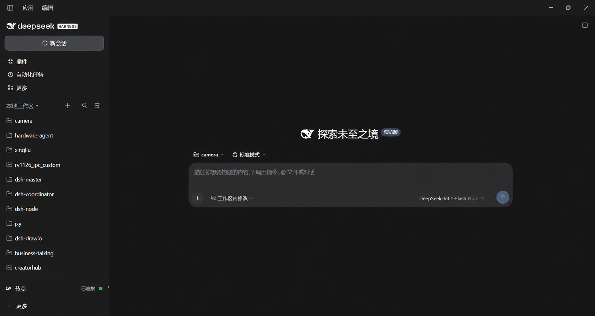

# dsh-master 添加工作区与会话归档开发交接

## 界面和交互

- **本地添加工作区。** 在「本地工作区」标题行、搜索图标左侧放一个普通浅灰色「＋」，与相邻图标对齐。悬停提示和无障碍名称均为「添加工作区」。点击打开目录选择器，确认后登记已有目录并展开对应工作区。用户取消时关闭选择器。重复选择已登记的目录时定位到已有工作区。
- **远程添加工作区。** 在当前远程节点的标题行提供相同的「＋」。选择或输入的是该节点上的已有目录，登记请求发给该节点。节点支持目录浏览时复用浏览能力，否则可用路径输入，由节点校验。成功后刷新该节点并展开对应工作区。已有目录行上的「＋」继续用于新建会话。
- **查看归档。** 在「本地工作区」和每个远程节点的当前范围里提供「已归档」入口。列表显示标题、工作区和更新时间，点击可打开历史会话。切换节点时列表随范围切换。无归档、加载失败和节点不支持分别显示对应状态。
- **取消归档。** 在已归档会话行的「…」菜单提供「取消归档」。由会话所属宿主确认后更新列表，会话回到原工作区并保留历史。恢复失败时保留归档行，显示具体错误。按宿主和会话 ID 定位，避免跨节点操作同名或同 ID 的会话。

## 实现顺序

1. **恢复本地入口。** 从 `src/workspace/rows/WorkspaceBrowser.tsx` 和 `src/workspace/index.ts` 查起。当前加号取决于本地范围和 `directoryFlowAvailable`，后者受目录选择器插槽占用及官方 `ui-workspace` 接管模式影响。先在实际 profile 复现并核对 `cordis.patch.yml` 与插槽注册，再修复入口或提供宿主侧路径输入作为可用回退。复用现有 `workspaces.create`，侧栏添加成功后直接定位工作区。
2. **接入远程登记。** 核对节点发布版本是否暴露 `workspace/create`。用 `src/workspace/RemoteSection.tsx` 管理目标节点和刷新，沿用 `src/client/api.ts` → `src/http-api.ts` → `src/service.ts` → `src/coordinator/client.ts` 的调用链。使用节点返回的工作区身份，继续按注册表的 `sessionIds` 确定会话归属。
3. **接入归档列表与恢复。** 优先复用工作区快照中的 `archivedSessionIds` 和已有会话摘要。确认目标版本的 `session/list` 能返回归档会话摘要，缺少摘要时通过该节点支持的会话读取能力补齐。本地从 `src/workspace/navigation.ts` 的 `unarchiveSession` 封装追到实际宿主。已检查的上游工作区控制器只暴露了归档操作，开发时应核对目标版本是否已有恢复能力。若缺少，恢复需要由节点侧或其依赖的工作区注册表实现持久化，再由 dsh-master 接入。在接口不可用的版本如实显示能力状态。

## 验收

- 本地加号位于搜索图标左侧。添加、取消、重复添加均可验证，重新加载后工作区仍可见。
- 在远程节点添加目录时，登记结果只出现在目标节点。无效路径或节点离线时显示错误，列表保持实际登记状态。
- 本地和远程均可查看归档历史。取消归档后，会话回到原工作区，刷新后结果一致。恢复失败时归档列表保持原状态。
- 执行 `pnpm run typecheck`、`pnpm test` 和 `pnpm run build`。通过实际宿主加载构建产物复验侧栏。若缺少真实节点或节点恢复接口，交接时列明未验证的场景和依赖。

## 一句交接 Prompt

> 请在 `G:\claude_project\code-agent\dsh-master` 先读 `AGENTS.md` 和 `docs/prompts/2026-11-23-workspace-add-and-session-archive.md`，按文档及效果图实现本地和远程标题栏的「＋」添加工作区、查看已归档会话和取消归档，核对宿主与节点的实际接口并完成验证，交付时列出改动、验证结果及任何尚缺的节点端能力。
