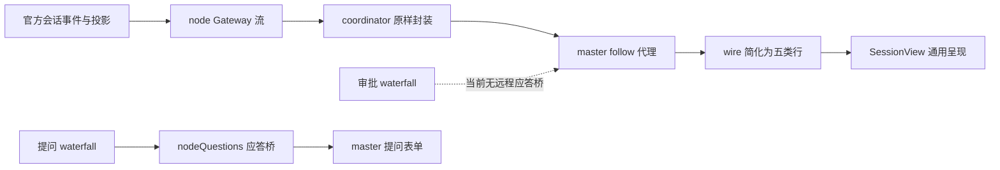

# DSH 会话信息卡差异调查

取证日期：2026-10-30（Asia/Shanghai）。范围：会话内容与会话内状态呈现。排除文件产物卡、下载、工作区侧栏；不改业务代码、不提交、不发布、不重启。

## 结论

缺口确实存在，而且不全是 UI 样式问题。当前远程视图把官方的结构化会话降成了“正文、通用工具折叠行、少数通知”，丢掉了工具元数据、状态投影和部分事件语义。

最先处理的应是**状态正确性**：真实会话中 4 条 `message.isError=true` 的工具结果，经当前 `wire.ts` 回放后产生 **0 个失败标记**。随后再补高频的终端、文件读取/diff、Todo/目标、思考与回合状态。审批需要新的应答链路，不能靠画一个允许按钮解决。

“官网”按项目 README、GROUND-TRUTH 和 SessionView 的语境，暂取为**官方 DSH 原生会话界面**；这属于有依据的工作假设，尚非用户确认的某个外网 URL。本报告没有比较 DeepSeek 网页聊天或其他产品，也不宣称已检查某个官网网页。

## 证据与局限

| 编号 | 已获取的证据 | 能支持什么 / 不能支持什么 |
|---|---|---|
| E1 | 正在运行的进程路径 `E:\DSH2\DeepSeek Harness.exe`；监听 `127.0.0.1:56574`；该端口 master API 返回 coordinator 在线，节点 `my-desktop` ready | 确认本次调查入口；不能用旧端口 53324 替代 |
| E2 | 从 `E:\DSH2\resources\app.asar` 直接读取官方包和源码；顶层 `@deepseek-ai/dsh-desktop`、runtime 及所查 UI 包均为 `0.2.1-rc.2` | 当前运行安装包的源码基线；不是文档中旧安装路径 `E:\DSH\DSH Desktop` 的 Desktop 2.0.18 基线 |
| E3 | desktop profile 的 `node_modules/dsh-master` 与 `dsh-node` 均为指向相邻仓库的 junction；运行中 `/dsh-node/api/diagnostics` 的客户端模块清单含官方 `ui-chat`、`ui-tool` 和 `dsh-master` | 证明挂载关系与模块进入启动清单；**没有证明内存中已物化的前端 bundle 与此刻磁盘字节完全一致**。构建文件哈希不能替代这一点 |
| E4 | 经 master → coordinator → my-desktop 的真实 `session/follow` 读取 5 个会话快照，保存去内容后的事件计数、字段名与元数据键 | 证明这些字段已经穿过真实远程链路；不等于真实模型新回合或 GUI 验收 |
| E5 | 将再次读取的 5 个真实快照送入当前 `src/client/wire.ts`，内存转译后调用 `readSnapshot`；仅保存汇总 | 验证解析结果及错误标记丢失；没有运行模型、执行工具或修改会话内容 |
| E6 | 原生窗口 AX 与一次正确的远程会话视觉观察：通用 read/edit/pwsh 行、正文中出现执行过程、未渲染事件计数、向上翻页提示 | 只作辅助观察。之后截图返回的画面与绑定窗口不一致，且有并行会话切换；未把这些图保存为可信截图，也未据此点击会话或推断根因 |

**本轮没有完成“同一个会话在官方本地 UI 与远程 UI 的成对截图验收”。** 独立 Chrome 页访问根页面显示 Web authentication required；未处理认证或读取凭据。原生截图通道的目标不稳定，因此停止后续窗口交互。下面“官方表现”均以当前安装源码为依据，逐项注明真实数据覆盖；没有官方真机截图的项目均不得称为视觉验收通过。

证据文件：

- [真实快照字段与事件汇总](evidence/live-snapshot-summary.json)
- [真实快照解析回放结果](evidence/wire-replay-summary.json)
- [运行入口与模块清单摘要](evidence/runtime-summary.json)
- [初始官方源码来源清单](evidence/source-manifest.json)
- [全部取证源码及当前工程文件哈希](evidence/audit-file-hashes.json)
- `sources/` 是从运行安装的 asar **复制**的官方源码证据，未改安装内容；文件名后的源码行号以这些副本为准。

两轮快照捕获时刻不同，活跃会话记录数可能略有变化，不能把两份 JSON 的数量逐项强行相等。哈希记录的是取证时磁盘内容，其他会话仍在修改工作区。

## 数据究竟丢在哪一层

主要收缩点是 **wire 的行模型与 SessionView**。但即时审批、后台任务实时输出、子会话地址等另有通道或参数需求，不能全部归为“前端再加一张卡”。

| 环节 | 实际调用者与字段 | 核查结果 |
|---|---|---|
| 官方生成 follow | 官方 session controller 的 `SessionFollowFrame`：`snapshot.records`、`projections.values`、`assistantStream`，以及事件帧、助手流帧 | `sources/dsh-api-session-controller-typert.host.js:250` 起；当前官方已知持久事件词表为 **62 类**，不是旧 GROUND-TRUTH 的 55 类。词表数量也不是卡片数量 |
| node | `stream-manager.ts:253` 的 `pump()` 遍历 `ctx.typertGateway.stream`；`:382` 的 `pumpOne()` 把原 `value` 放入 `stream.data` | 不按工具或事件类型筛选；超帧大小会报错，而非静默去字段。真实 master 端已读到 `meta.diffs` 等，故样本中的这些字段未在 node 丢失 |
| coordinator | `http-api.ts:855` 起遍历 stream，写 `{type:'data', value}` | 本地源码无卡片类型过滤；部署服务未逐文件验 SHA，不能宣称远端磁盘与本地源码完全相同。但真实末端快照可直接证明样本字段已通过部署链路 |
| master 服务 | `coordinator/client.ts:578` 的 `follow()` 发 `assistantStream:true`；`http-api.ts:199` 的 `streamFollow()` 原样写 `value` | 助手流并非完全未请求。当前浏览器仅订阅 follow，没有信息卡所需的全部其他流/操作 |
| master 解析 | `wire.ts:16` 仅五种 `ConversationRow.kind`；`:163` 的 `rowOf()` 只认 user、assistant、tool call/result、approval asked/decided、command run | 只保留 text/detail/output/failed；丢弃 `meta`、投影、工具层级、事件 placement 等信息 |
| master 呈现 | `SessionView.tsx:114` 的 `Row()`：所有工具共用 details/pre；`:532` 起消费 snapshot/event/stream；`:809` 统一未渲染提示 | 工具已识别却缺专用 UI，与未识别业务事件并存。`phase='live'` 表示流连接已开，不能等同模型正在运行或回合成功 |

当前官方 `session/control` 的客户端调用在 `sources/dsh-api-session-controller-client.js:389`，其当前 schema 以投影 baseline/replacement 为主。**不要照搬旧文档中“control 同时给 queues/jobs”的描述**：本版本官方 Jobs UI 实际通过 `remote.job.list` / `remote.job.follow` / `remote.job.kill` 工作，见 `sources/dsh-api-job-controller-client.js:217,268,297`。

## 真实样本说明

以下为 E5 的解析回放统计。`未渲染`包含 step、日志投递确认等内部事件，**不代表遗漏了同等数量的用户信息卡**。

| 会话 | 快照记录 | 渲染行 | 未渲染计数 | `message.isError=true` | wire 失败标记 |
|---|---:|---:|---:|---:|---:|
| DSH 会话双向文件附件实现 | 359 | 95 | 213 | 1 | 1 |
| 查询识别日志是否存在 | 344 | 93 | 195 | 5 | 5 |
| GPU推理选项实现 | 305 | 71 | 191 | 2 | 2 |
| WebSocket视频帧解码错误排查 | 193 | 59 | 108 | **4** | **0** |
| 烧脑中Ing | 239 | 84 | 108 | **2** | **1** |

样本已经覆盖：read、read_image、edit、write、pwsh、glob、grep、todo_write、get_goal/update_goal、job_output/job_kill；以及审批、重试、goal/change、todo/write、job registered/settled、workspace changes、turn end 等。五个样本中未获取到 compaction、子代理、team、workflow-run、plan 提交的业务事件，不能据此判断这些事件永远不会发。

快照 `projections.values` 还携带 `goal`、`todos`、`tokenUsage`、`contextPressure`、`contextBreakdown`、`inbox`、`sessionStats`、`turnOutline`、`permissions`、`subagentCatalog`、`subagentTiming`、`plan`、`modelSelection` 等**键**。目前汇总只记录键名，不能据键存在断言其值有效或状态已激活。

## 逐项对比

标记：**实**＝真实远程输入 + 源码；**源**＝仅源码、没有对应真实业务样本；所有项目的同场景官方/远程成对截图均待补。P0 为正确性或操作阻塞，P1 为常用可读性，P2 为进阶场景。优先级是本轮建议。

| 信息类型 | 官方表现（当前安装源码） | 当前 master 表现 | 证据 | 缺失环节 | 用户影响 / 优先级 |
|---|---|---|---|---|---|
| 1. 工具失败、中断状态 | `rootResult` 读取 `message.isError`，工具模型区分 error、stopped、running、ok | 仅 `data.error` 决定失败，某些真实失败显示普通完成；调用/结果合并本身在样本中正常 | **实**：E5 中 4→0、2→1；`ui-chat:10177`、`ui-tool:307`；`wire:132` | **master 未完整识别字段**，不是纯 UI；不能只归因版本 | 错把失败当成功，误读执行结果。**P0** |
| 2. 通用工具输入/输出与层级 | 工具调用树；按 callId、parentCallId、PTC 子调用归并；展开完整内容，按需专业呈现 | callId 折叠行已有；参数在解析时截为 800 字，结果 4000 字；展开也无法恢复被截内容；PTC 事件未处理 | **实+源**：E5 callId 对齐均成功；`ui-tool:1935,1976,2013`；`wire:188,201` | 已识别工具，但**模型丢字段与内容**；PTC 属未识别事件。PTC 无真实样本 | 长命令/诊断输出缺失，嵌套执行不可追踪。**P1** |
| 3. 终端/命令执行卡 | `terminalCardModel` 从命令参数、`meta.cwd`、状态尾标记等得到 cwd、命令、输出、exitCode/signal；部分特殊结果仍走 generic | pwsh/bash 等统一为工具名 + 输出首行；输入是原始 JSON，缺终端结构与退出状态 | **实**：大量 pwsh、`meta.cwd`；`ui-tool:977,1867,2486`；`SessionView:114` | **已识别但缺 UI**，且 wire 丢弃元数据。不能承诺所有持久 shell 输出均能直接转终端卡 | 难分辨执行内容、目录、退出原因。**P1** |
| 4. 文件读取卡 | `readCardModel` 使用 `meta.path/offset/lines/totalLines/lang`，展示文件内容及语义摘要 | read 输出纯 pre；没有行号/语言/文件范围的模型；长内容截断 | **实**：E5 metadata keys；`ui-tool:446,2723`；`wire:132` | **已识别但丢 meta、缺 UI**。打开远端文件还需要节点资源路由 | 读代码和定位片段费力。**P1** |
| 5. 文件变更/diff 卡 | `diffCardModel` 结合写入/替换参数与 `meta.diffs`；失败与不完整元数据有 fallback | edit/write 显示成功文本，原始 diff 元数据未进入行；`workspace/changes` 仅进未渲染计数 | **实**：真实 `meta.path,diffs`；`ui-tool:558,2646`；E4/E5 | **已识别工具但丢数据、缺 UI**；workspace changes 只有 turn 不能凭空还原完整 diff | 无法在会话内审阅改动。**P1**。本项是代码变更呈现，非产物卡/下载 |
| 6. grep/glob 搜索结果 | `searchCardModel` 使用 shape、files/paths、truncated、total，区分路径与命中内容 | 原始输出文本；缺结果分组、命中范围和截断提示语义 | **实**：真实搜索 meta；`ui-tool:632,2944` | **已识别但丢 meta、缺 UI** | 查找结果难扫读。**P1** |
| 7. Todo/步骤进度 | `TodoRow` + todo 历史模型比较本次列表与基线，展示任务变化；不是仅把 todos JSON 打印出来 | todo_write 通用行；`todo/write` 未识别；`projections.todos` 不消费 | **实**：todo/write + todo_write；`ui-tool:4347,4505`；`wire:163` | **master 未识别事件**且已有工具缺专用 UI；无需先改 coordinator | 用户看不见已完成/进行中任务。**P1** |
| 8. 长期目标状态 | GoalDock 从 `goal` 投影显示目标状态，编辑/暂停/恢复等使用 goals RPC 和 activation 事件 | get_goal/update_goal 只是原始调用；goal/change 不渲染；goal 投影不消费 | **实**：真实 goal/change；`ui-goal:590,604` | **事件/投影未识别 + 缺 UI**；目标操作与 activation 实时同步另需代理通道 | 看不到目标是否还在推进。先只读目标摘要 **P1**；操作 **P2** |
| 9. 思考折叠与实时生成 | ReasoningDisclosure 独立折叠；助手块按 reasoning/response 组织；有流式装配 | `blockText` 将 reasoning 与 text 一起拼进正文；assistant-stream 只开关运行指示，忽略 chunk；snapshot.assistantStream 不恢复显示 | **实**：E5 每样本均见 reasoning；`ui-chat:6151,6257,10845`；`wire:90,346` | **已识别但语义/呈现不完整**。实时 chunk 格式存在版本耦合，不能仅据源码宣称真机流式已通 | 过程文字淹没答案，等待时缺进度。**P1** |
| 10. 回合过程、重试、用量与错误 | turn-process、model-retry、turn-error 等独立节点；重试次数/延迟、失败原因、回合统计可见 | step/turn/llm retry 事件大多只累加未渲染计数；phase 主要反映 follow 连接，不反映最终业务状态 | **实**：llm/retry、retry-started、turn/end、usage 字段；`ui-chat:10023,10517,10679` | **master 未识别/未建状态模型**；部分统计来自投影。无真实 terminal turn-error 样本 | 长时间无答复时不知在重试、完成或失败。**P1**；致命失败提示优先 |
| 11. 授权审批 | pending-interaction 审批面板，有理由、工具、允许一次/拒绝；`remote.$on('approval/request')` 回答 waterfall | 审计事件 asked/decided 只显示两条 notice；无待审批表单/应答接口 | **实**：历史 asked/decided 已穿透；**源**：`ui-approval:48,284,355`、`user-approval:176`；node 当前只安装问题桥 | **远端没有专用审批应答桥 / master 无对应应答通道**，而非 coordinator 没转发普通 follow 审计事件。节点若无其他应答者会 unavailable 关闭 | 部分需批准操作无法远程继续；已有本地应答者时行为另看部署。**P0/P1**（是否常用取决权限策略） |
| 12. ask_user_question | 交互表单、多题、多选、自定义、历史问题摘要/复查入口；活跃请求通过独立回答通道 | **已经实现**远程问题表单与 nodeQuestions pending/answer/cancel；历史工具行仍通用，缺官方的已答问题专用摘要/复查体验 | **源**：`ui-tool:2279,2424`、`ui-user-questions`；`SessionView:184,560,823`；master `coordinator/client:475`；node `index:1766` | 活跃交互不能报“全缺”；**旧节点能力不兼容**与**历史展示不足**分开。目前未触发真实新问题作成对验收 | 保持已有能力，优先补历史摘要。**P1**；兼容提示需保留 |
| 13. 子代理目录与子会话 | 目录状态/父子关系、子会话打开与 one-shot 只读规则；工具有子代理语义 | subagent 调用通用工具行；subagent/catalog/descriptor 不解析，子会话导航未接入 | **源**：`ui-subagent:937,958`；`ui-tool:4188`；follow schema 支持 kind=subagent | **master 未识别 + 路由参数不足**。当前 master 只传普通 sessionId；官方 parent/child/mode 地址不能直接照塞 | 多代理协作过程不可追踪。**P2**（高频使用可升 P1）；5 个样本无事件 |
| 14. 后台任务 / 作业 | Jobs 入口列 running/settled，可观察输出并终止；实际调用 `job.list/follow/kill` | job/registered、job/settled 未渲染；job_output/job_kill 普通工具行；没有专用 job 订阅/观察 UI | **实+源**：真实 job 事件；`ui-jobs:323,627`、`api-job-controller-client:217,268,297` | **已到达的历史事件未识别**；**实时 roster/output 通道未订阅**。不能说补 follow 卡就有完整作业管理 | 不知后台命令何时完成或如何查看结果。只读状态 **P1**，观察/终止 **P2** |
| 15. 命令完成、上下文压缩 | 普通命令 run/done；compaction 有状态、记录/token 数和可展开摘要 | command/run notice 已有，done 被忽略；compaction start/summary/end 未识别 | **实**：command run/done；**源**：`ui-chat:4327,6500,9624,9679` | **master 未识别业务事件**；压缩无真实样本，不等于远端未发送 | 无法得知命令完成或上下文为何变化。**P1/P2** |
| 16. 计划模式与计划审阅 | plan 投影 chip；识别 `exit_plan_mode` 的 tool/call 与 PTC，形成计划审阅及预览 | 工具若出现仅 generic；plan/mode 不渲染、plan 投影不消费；未接计划审阅交互 | **源**：`ui-plan:240,503,654,672` | **master 未识别 + 缺 UI/操作**。审阅与一般 ask_user_question 不是可以直接等价替换的 UI | 长计划难阅读和确认。**P2**；无真实提交样本 |
| 17. 工具图片、网页检索内容 | read_image 从 image block 的 attachment 引用取图；web 搜索/抓取解析来源、状态码、截断等 meta | image block 只剩 `[image]`；web 走 generic；不消费对应 meta/attachment 引用 | **实**：有 read_image 调用，未保存图片引用值；**源**：`ui-tool:1070,2782,2804,2879,4557` | **丢结构字段 + 缺专用 UI**；图片二进制还需节点资源读取桥。不能误用本机相同路径读图 | 看不见模型引用的画面或来源结构。图片 **P1**，web **P2**。非文件产物交付范围 |
| 18. 工作流、团队、动态插件卡 | workflow-run 折叠阶段与成员状态；实验团队 TaskCard/MemberRow；Cordis 有 define/run/action 及运行内容插槽 | 对应工具 generic，tool-workflow/*、team/* 不解析；动态插件内容未桥接 | **源**：`ui-workflow-run:596,650`、`experimental-client-ui-agent-team:88,146`、`ui-cordis:51,77,1448` | **master 未识别 / 插件协议与 UI 缺适配**；实验插件是否在当前 profile 启用未逐项确认 | 复杂协作的信息损失较大；不能承诺每个官方安装包必然激活这些卡。**P2** |

其中 `ui-xxx` 为 `sources/dsh-client-ui-xxx.js` 的简写；`api-xxx-client` 为对应 `sources/dsh-api-xxx-client.js`。工程路径省略前缀时均相对当前 dsh-master；node/coordinator 的文件明确在表中标注。

## 不应混淆的三件事

1. **未渲染计数不应当作“还缺几百种卡片”。** 例如 session-log-deepseek/delivery-accepted 与 step bookkeeping 通常无需独立大卡；更适合做状态聚合或调试明细。应为未知业务事件保留可展开的类型摘要，而非把所有事件堆到主会话。
2. **版本兼容提示只用于真实能力缺失。** my-desktop 已传来 diff、todo、goal、重试、job 等；这些不能一概要求升级 node。相反，旧节点缺 nodeQuestions、图片资源或其他 namespace 时应明确标注不支持。本轮没有读齐 offiec1 的运行包版本，不能把其提示直接推广到 my-desktop。
3. **官方整套 UI 不能直接对远程 sessionId 复用。** 官方工具视图依赖本机 sessions、uiConversation、resources、jobs、单例插槽及本地绑定。可复用 primitives 和抽取纯模型思路；若复用官方业务组件，必须先做带 nodeId 的资源/会话适配，否则可能误读本机同名资源。现有 SessionView 顶部说明与安装源码一致支持这项约束。

## 分阶段补齐建议（待选择后实施）

| 阶段 | 交付内容 | 验收重点 | 依赖与边界 |
|---|---|---|---|
| A：正确解释已收到的数据 | 修复 isError；保留工具 meta/完整输入输出；区分 stopped/error；致命回合失败与重试状态；不再用连接状态代替业务状态 | 以上 4 条失败全部正确标红；callId 合并不重复；刷新后状态一致；全文展开可恢复完整数据 | master 为主；先固定真实事件脱敏 fixture。需覆盖 data.error 与仅 message.isError 两类输入 |
| B：高频只读卡片 | 终端、read、edit/write diff、grep/glob、Todo、目标摘要；思考独立折叠；按回合组织过程与答案 | 同一真实会话，本地官方/远程成对截图；同样工具参数/结果可定位；元数据缺失降级不编造 diff/退出码 | 大部分数据已到达；先不扩写权限/文件资源操作。保留通用 fallback |
| C：交互闭环 | 审批请求/应答桥；历史问答摘要；后台作业实时观察；计划审阅 | 在真实远程模型回合触发请求，回答返回原调用；切会话、撤回、断线、超时均正确失效；历史审批不能重新点击授权 | 审批需 node responder、请求身份/有效期/取消及 master API；job 使用实际 job namespace；不能只提交普通 prompt 当应答 |
| D：复杂协作与兼容 | 子代理地址/目录/状态；workflow/team；工具图片资源；必要的 Cordis 专用视图 | 真实相应插件启用后逐类验证；one-shot 只读；节点/会话切换不串数据；旧节点明确降级 | 每项按能力探测单独推进，不一次移植官方全部 renderer。实验功能按使用频率选做 |

此外，向上翻页是覆盖完整历史的基础条件，应在选择实现时单独评估；目前 5 个样本中 4 个 `hasMore=true`。它不是新的信息卡类型，本报告只记录，不在本轮改动。

## 卡片示意（建议稿，不是官方截图或已实现 UI）

见 [CARD-SKETCHES.svg](CARD-SKETCHES.svg)。建议保持“紧凑摘要 → 展开结构化详情 → 原始输入/输出兜底”，避免每次工具调用都变成很大的面板。需要用户行动的审批/提问应明显区分于历史记录。

示意中的数值、命令、任务名称均为虚构，不来自用户会话；按钮仅表达布局，没有接入真实操作。它们用于选择方向，不承诺与官方像素一致。

## 验证与未完成项

- 完成：安装版源码取证、真实链路 5 会话快照读取、当前 parser 5 样本回放、错误字段比对、node/coordinator/master 调用链追踪。
- 未完成：同会话成对真机截图；当前物化前端 bundle 字节核对；真实新回合的审批/问题/子代理/计划/压缩/工作流验收；远端 coordinator 文件哈希与所读本地源码逐文件核对。
- 本轮未构建、未跑整仓单测：只新增调查文档与证据，避免影响其他会话正在工作的业务文件与构建产物。解析回放是本报告的针对性验证，不等同自动化测试全绿。
- 不在范围：产物卡/下载与侧栏，由其他会话处理；已看见相关代码与界面提示，但未修改或展开诊断。

下一步选择建议：先批准 A+B；审批按实际阻塞程度插入 C。若只允许做一项，先修 `message.isError` 的识别，避免把失败表现成完成。
