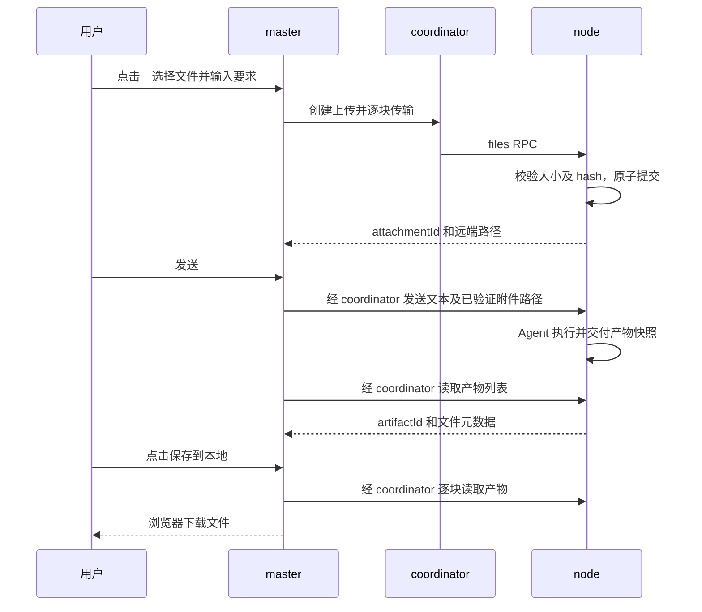
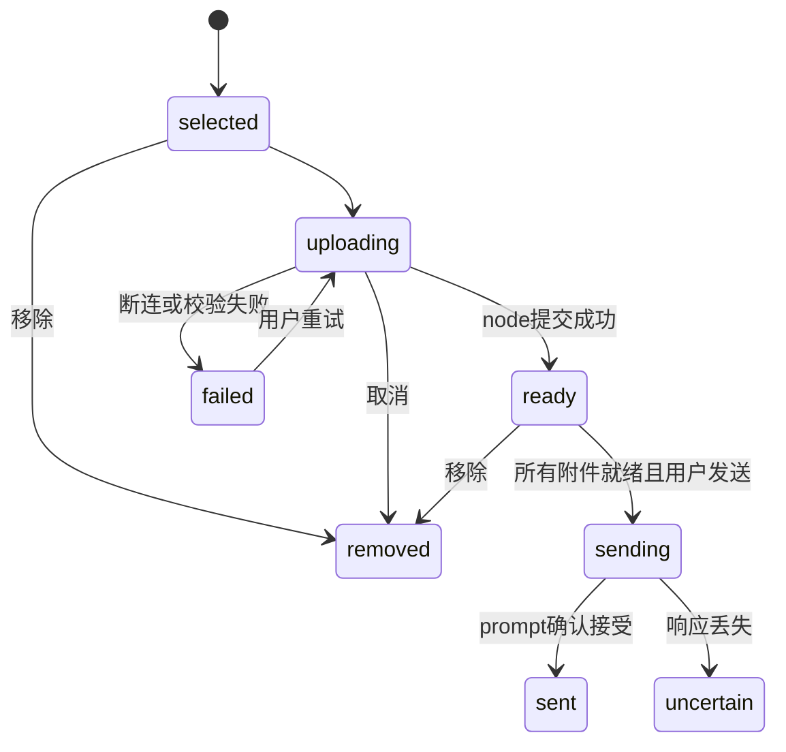

# 远程会话双向文件附件开发计划

> **For agentic workers:** REQUIRED SUB-SKILL: Use superpowers:executing-plans to implement this plan task-by-task. Steps use checkbox (`- [ ]`) syntax for tracking.

**Goal:** 用户通过远程会话输入框的“＋”上传本地文档，node 读取附件并执行任务；node 交付的文档在会话中显示文件卡片，用户可下载到本机。

**Architecture:** master 负责附件交互和同源 HTTP 接口，coordinator 继续承担认证与 RPC 路由，node 负责文件落盘、会话归属和产物登记。沿用 node 主动建立的 WebSocket，通过小块 RPC 传输二进制文件，不新增 node 入站端口，不在 coordinator 持久存文件。

**Tech Stack:** 现有 Node.js >=20、TypeScript、React 18、Cordis、ws、Vitest；文件操作及 SHA-256 使用 Node 标准库，首版不引入对象存储、传输框架或新运行时依赖。

**Spec:** 本文第 1—5 节是用户已确认范围的设计细化，第 6 节为实施任务。用户确认的是功能范围；下列容量、保留周期与协议命名是本次提出的工程默认值。

> **执行记录（2026-10-29）：** 三个仓库的代码、测试与文档已落地；未执行 Git 提交、发布或部署（用户明确要求）。
> 安装宿主探针证据见 `docs/superpowers/specs/2026-10-29-session-files-contract.md` §1.1；
> 三仓库真实进程联调见 `tools/e2e-session-files.mjs`（20 项检查全部通过）。
> 最终测试：dsh-node 573、dsh-coordinator 394、dsh-master 239（1 skipped）；
> 三仓库 `tsc --noEmit`、`tsc -p tsconfig.build.json`、`tsdown` 均通过。
> 真实远端会话/真机 GUI 场景仍未验证，对应勾选保持未完成。

## Global Constraints

- 支持单个或多个普通文件，保留二进制原文；不做文件内容提取、OCR 或格式转换。Agent 能否理解 PDF/DOCX 等，仍取决于 node 上已有工具。
- 不包含目录上传、目录同步、`@` 本地文件搜索、内容预览、跨重启断点续传和自动推送到本机固定目录。
- 只在当前选中的 node/session 内使用附件，不允许凭路径访问另一会话文件。
- 不覆盖现有文件；文件名仅供展示，落盘使用服务器生成的 ID。
- 全部附件提交成功才允许发送关联任务；既有无附件消息和 queue/steer 行为保持兼容。
- 上传沿用 `allowPrompt` 开关：关闭时拒绝新上传和新任务；已登记产物仍可下载。
- 单文件 20 MiB、每消息最多 5 个文件、每节点最多 2 个活跃上传、node 附件存储上限 1 GiB（含产物快照与临时文件）。这些值由 describe 返回，前端不另设权威限制。
- 原始分块 256 KiB；base64 RPC 不超过 512 KiB；不提高全局 HTTP/WS 限额。若部署现有限额更小，报告不兼容，不静默修改配置。
- 不完整上传闲置 1 小时回收；完整附件及产物默认保留 7 天，读取不续期。UI 显示到期时间，元数据保留以呈现“已过期”。
- 每次文件 RPC 使用现有单请求超时；传输不继承一个覆盖整文件的 30 秒总截止时间。取消通过 AbortSignal 传递并回收文件句柄。
- master 凭据只在宿主；coordinator 的 operator 和 node 认证、现有信任围栏及节点撤销检查不得绕过。
- 本轮仅创建计划，不修改业务代码、不执行发布、不自动提交。

## Review Focus

1. A 节点附件不能因切换到 B 节点或其他会话而被误发；任务 5 覆盖。
2. 磁盘满、超限、截断和 hash 不符不能产生可用附件或触发 Agent；任务 2、4、5 覆盖。
3. 中文同名文件、Windows junction、符号链接及目录穿越不能造成覆盖或越权；任务 2、3 覆盖。
4. 上传成功但 prompt 响应丢失，不能通过自动重试重复执行任务；任务 4、5 覆盖。
5. 产物登记后原文件改变、刷新页面或 node 重启，仍应得到登记时的文件或明确失效提示；任务 3、6 覆盖。

## 1. 现有实现与改动边界

| 仓库 | 已确认入口 | 本次职责 |
| --- | --- | --- |
| dsh-master | `src/client/SessionView.tsx` 中 submit 调用 sendPrompt；`src/client/api.ts`；`src/http-api.ts`；`src/service.ts`；`src/coordinator/client.ts` | 附件选择、传输、发送门控、产物卡片、下载 |
| dsh-coordinator | `src/http-api.ts` 的 HttpApiHost.invoke；`src/server.ts`；`src/protocol.ts` | 为文件 RPC 提供带认证的显式 HTTP 入口，继续使用既有 invoke |
| dsh-node | `src/index.ts` 的 installAdminSurface/typert 注册；`src/admin/path-policy.ts`；`src/admin/service.ts` | 新增会话附件服务和 Agent 产物交付工具 |

node 已有管理面文件读写，但单次读取上限 1 MiB、写入上限 4 MiB；node/coordinator 默认 WS 帧上限均为 4 MiB。因此不直接传输整个文件、不把完整 base64 放进 prompt。

当前 master 插件路由位于宿主浏览器登录鉴权之外，信任围栏本身不是身份认证。文件路由必须额外限制为回环来源连接，并继续检查 Host/Origin/Fetch Metadata；外部浏览器访问暂不在本版范围。不能仅凭 trustedHosts 放开文件下载。

仓库根路径均为 `G:/claude_project/code-agent/` 下的对应项目。仅 master 在当前可写工作区；后续执行到另两个仓库时需使用相应项目工作区或经授权的文件访问方式。本轮对它们仅做只读检查。

## 2. 用户流程

选择文件后开始上传，展示 node 已确认接收字节数；上传完成后状态为“可发送”。点击发送前所有附件必须 ready，且文本非空；首版不支持仅附件自动生成任务。失败保留草稿和附件，允许手动重试或移除。发送成功后清空本次草稿。

下载使用浏览器原生下载，保存到用户浏览器配置的下载位置；启用“下载前询问位置”时可选择位置。首版不承诺强制弹出原生路径选择框，不接受浏览器传入本机任意写入路径。目标是下载到运行 GUI 的设备，当前场景中该设备就是 master 本机。

## 3. 文件身份、存储和交付

- AttachmentRef：`{attachmentId,nodeId,sessionId,name,size,sha256,remotePath,createdAt,expiresAt}`。
- ArtifactRef：`{artifactId,nodeId,sessionId,name,size,sha256,createdAt,expiresAt,state}`，state 为 ready/expired/missing；不向浏览器暴露产物源文件绝对路径。
- node 内部元数据以 `(nodeId,sessionId,id)` 绑定；不能只检查 ID 存在。
- 存储目录为 `$DSH_HOME/dsh-node/files/<sessionKey>/`，sessionKey 使用 sessionId 的 SHA-256，避免将外来 ID 拼入路径；下分 incoming、attachments、artifacts、manifests。
- UUID 用作实际文件名，原文件名只保留在元数据。目录仅当前运行用户可写；POSIX 使用 0700/0600，Windows 使用运行账户的继承 ACL，并验证不存在放宽权限的自建目录。
- 上传先写临时文件，校验声明大小、实际大小和逐块累积 SHA-256 后原子 rename；元数据原子写入。崩溃恢复扫描并修复孤立状态，不能把半文件标为 ready。
- Agent 通过 `deliver_file({path,name?})` 交付产物。sessionId 从工具运行上下文获取，不能由模型指定任意会话。
- 交付只允许会话真实工作目录或该会话附件目录内的普通文件，复用现有路径策略；必须验证 realpath、junction/symlink、文件类型及会话归属。
- 交付时复制成只读产物快照，大小及 hash 取快照内容；原文件随后修改或删除不影响下载。复制前后检查源文件身份和属性，发现并发修改时拒绝交付并提示重试。
- 下载始终凭 artifactId 读取快照，不能提供任意远端 path 下载接口。每次 RPC 重新检查会话归属、节点状态和到期状态。
- 到期清理快照/附件字节，保留失效元数据。若 Agent 仍在使用到期附件，允许本次已打开读句柄结束；后续访问明确失败。

## 4. 协议草案

新增 node 的 `sessionFiles/*` Typert unary 能力；由 coordinator 固定映射操作，不开放任意 endpoint 透传。

| 操作 | 参数（均含 sessionId） | 返回 |
| --- | --- | --- |
| describe | 无其他参数 | protocolVersion:1、容量限额、交付工具可用状态 |
| beginUpload | name,size,clientUploadId | uploadId,chunkBytes |
| writeChunk | uploadId,offset,base64 | nextOffset |
| commitUpload | uploadId,size,sha256 | AttachmentRef |
| abortUpload | uploadId | accepted |
| resolveAttachments | attachmentIds | 已校验的 AttachmentRef[] |
| listArtifacts | 无其他参数 | ArtifactRef[] |
| readArtifactChunk | artifactId,offset,length | base64,nextOffset,totalSize,sha256 |

clientUploadId 为浏览器 UUID，按会话去重 beginUpload；同 offset、同内容重传返回相同 nextOffset，不重复写入；不同内容或不连续 offset 拒绝。commitUpload 重复调用返回原 AttachmentRef。取消只影响临时上传，不删除已经发送任务的附件。

浏览器按块计算 SHA-256，node 独立累计校验；避免要求浏览器把整文件转成 base64。若标准 Web Crypto 无增量接口，首版可在 20 MiB 上限内单次 ArrayBuffer 计算 hash，限制同时 hash 一个文件；上传仍按块读取，不新增 hash 库。

coordinator：`POST /api/files/:operation`，JSON 请求含 nodeId/sessionId 和操作参数，operator token 鉴权，复用 `host.invoke` 与取消。operation 必须来自上表，逐项验证请求，不接受原始 endpoint。复用现有 capability 查询判断旧节点不支持。

master：

- `POST /dsh-master/api/files/:operation`：代理 describe/beginUpload/writeChunk/commitUpload/abortUpload/listArtifacts；不将内部 resolveAttachments 作为任意路径解析接口暴露。
- `GET /dsh-master/api/files/download?nodeId=&sessionId=&artifactId=`：读取产物元数据，逐块校验并流式输出二进制，响应使用安全的 Content-Disposition（含 UTF-8 filename*）、octet-stream、no-store 和 nosniff。
- 下载使用预期长度及 SHA-256 做完整性验证；设置准确 Content-Length，服务端至少保留最后一个块，hash 完全通过后才写出末块并结束。中途失败销毁响应，不能在二进制流后追加 JSON。响应头发送前的错误仍用现有 JSON envelope。集成测试必须证明下载中断不会被当成完整成功文件。
- 扩展既有 prompt body：`{nodeId,sessionId,text,mode,attachmentIds?}`；master 服务先 resolveAttachments，再由服务器追加 JSON 转义的附件清单及 remotePath 到 prompt，不采信浏览器传入的远端路径。附件内容按用户资料处理，不提升为系统指令。
- 所有文件 API 限制元数据长度、块长度、base64 合法性和解码后字节数，先做围栏/来源/权限检查再读请求体。

文件 RPC 使用 `files/invalid-arguments`、`files/unsupported`、`files/too-large`、`files/quota-exceeded`、`files/not-found`、`files/forbidden`、`files/expired`、`files/hash-mismatch`、`files/offset-conflict`、`files/io-error`。前端按 code 提示并保留可重试状态，不依赖解析错误文字。

## 5. 状态、兼容与失败规则

- 切换 node/session 取消正在进行的上传、清除当前附件选择；已完成而未使用的附件到期回收。异步回调用会话键检查，不能写入新会话状态。
- 传输串行逐块等待确认，实现有界背压；不同文件最多两个活跃上传。客户端在响应丢失但连接可恢复时可重发同一块；不支持进程重启后的续传。
- prompt 失败若能明确判断未接受，保留附件允许手动发送；接受状态不明时显示“发送结果未确认，请先查看会话”，不自动重新提交，附件协议不扩展为新的任务调度器。
- 旧 node/coordinator 不支持文件接口时禁用“＋”并显示升级提示；纯文本功能仍可用。
- 产物列表打开会话时获取，执行中每 3 秒刷新，页面隐藏时暂停；任务结束后再刷新一次。列表按 artifactId 去重，刷新与 node 重启后仍显示已持久化卡片。
- 注册了传输 RPC 并不意味着 Agent 会交付文件；必须将 deliver_file 注册到实际会话可用工具，并在含附件任务中附带交付说明。模型未调用工具时不伪造卡片；允许用户要求它“交付这个文档”。

## 6. 实施任务

### Task 1：确认当前宿主工具接入，冻结跨仓库契约

**Files:** master `docs/superpowers/plans/2026-10-29-session-file-attachments.md`（本文）；新增 `docs/superpowers/specs/2026-10-29-session-files-contract.md`；node `src/index.ts` 与安装宿主只读核对。

**Interfaces:** 产出本文第 4 节的精确 TS request/result 类型和 JSON fixtures，三个仓库复制同一组契约 fixtures；不新增共享发布包。

- [x] 检查当前安装的 dsh-tools、工具运行上下文、当前 sessionId 获取方式及工具白名单/preset，记录实际符号、版本和可运行注册示例。旧源码中的 ctx.tools.register 只能作线索，不能直接认定当前宿主兼容。
- [x] 验证注册测试工具后，目标 Agent 真正能调用，且运行上下文包含真实会话身份；无此能力则记录明确阻塞，先解决工具适配，不以“解析回复路径”降级冒充完成。
- [x] 固定 AttachmentRef/ArtifactRef/limits/error 类型、RPC descriptors 与 HTTP fixtures；包含无效 base64、重复块、旧节点、跨会话请求。
- [x] 用安装宿主完成最小工具调用探针，保存脱敏结果；删除探针。只确认契约与宿主兼容，不写正式业务。
- [x] 检查三个仓库现有改动与项目约定，记录基线；提交按用户要求省略（不自动提交 Git）。

**验收：** 工具注册和会话身份有真实宿主证据，契约不存在待定参数；后续任务只能依赖冻结后的接口。

### Task 2：node 附件存储和传输 RPC

**Files:** 新增 node `src/files/types.ts`、`src/files/store.ts`、`src/files/service.ts`、`test/files-store.test.ts`、`test/files-service.test.ts`；修改 `src/index.ts` 注册能力并负责生命周期回收。

**Interfaces:** `SessionFileStore.beginUpload/writeChunk/commitUpload/abortUpload/resolveAttachments` 对应第 4 节参数和 Promise 返回值；`SessionFilesOwner` 提供相同命名的 Typert 方法。

- [x] 编写失败测试：PNG/ZIP/DOCX 二进制 round-trip；零字节文件；20 MiB 接受、20 MiB+1 拒绝；SHA 不符不提交；同块重试幂等、错 offset 拒绝；同名中文文件不覆盖；跨会话读取拒绝；磁盘错误不产生 ready。
- [ ] 运行 `pnpm exec vitest run test/files-store.test.ts test/files-service.test.ts`，确认因新能力缺失失败。（实现与测试同批完成，未保留红灯记录；测试本身已覆盖这些失败分支。）
- [x] 实现有界写入、增量 hash、原子提交、按会话验证、节点配额与到期回收；元数据重启恢复；复用 Typert descriptors 注册方式，不改通用帧协议。
- [x] 增加 symlink/junction 越界、重启后临时文件回收、并发配额竞态和关闭时文件句柄释放测试；重跑上述命令及 `pnpm typecheck`，预期全部通过。
- [ ] 提交 node 本任务变更。（按用户要求不自动提交。）

### Task 3：node 的 Agent 交付工具与产物快照

**Files:** 新增 node `src/files/deliver-tool.ts`、`test/files-deliver-tool.test.ts`；修改 `src/files/store.ts`、`src/files/service.ts`、`src/index.ts`；复用 `src/admin/path-policy.ts`。

**Interfaces:** `deliver_file({path:string,name?:string}) -> Promise<ArtifactRef>`，会话身份来自 Task 1 已验证的宿主上下文；新增 Store `publishArtifact(sessionId,path,name?)`，RPC 提供 listArtifacts/readArtifactChunk。

- [x] 编写失败测试：会话内文件交付成功；越界、目录、链接逃逸与伪造 sessionId 拒绝；登记后原文件改变/删除仍下载原快照；过期和损坏快照返回明确错误。
- [ ] 运行 `pnpm exec vitest run test/files-deliver-tool.test.ts`，确认失败。（实现与测试同批完成，未保留红灯记录。）
- [x] 实现路径策略、快照、原子元数据和工具注册；验证工具在当前 Agent preset 中可调用；向任务附加交付工具说明，不改写全局用户规则。
- [x] 补齐快照复制期间源文件变化、配额不足、进程重启后列表恢复、中文显示名与列表去重测试；运行上述测试与 `pnpm typecheck`，预期通过。
- [ ] 提交 node 本任务变更。（按用户要求不自动提交。）

### Task 4：coordinator 路由和 master 宿主 API

**Files:** coordinator 新增 `src/files-api.ts`、`test/files-api.test.ts`，修改 `src/http-api.ts`；master 新增 `src/files-api.ts`、`test/files-api.test.ts`，修改 `src/http-api.ts`、`src/service.ts`、`src/coordinator/client.ts`、`src/protocol.ts`。

**Interfaces:** coordinator `handleFilesApi(request,response,host,signal)` 使用现有 invoke；master CoordinatorClient 新增 `fileOperation(nodeId,operation,args,signal?)`；MasterService 新增附件解析、列表、下载，prompt 接收可选 attachmentIds。

- [x] 编写两端失败测试：operator 认证、撤销/offline 节点、未知操作、能力缺失、上传关闭；master 非回环来源拒绝；跨站 GET 下载拒绝；超限在分配大内存前拒绝。
- [ ] 分别运行 `pnpm exec vitest run test/files-api.test.ts`，确认新路由未实现而失败。（实现与测试同批完成，未保留红灯记录。）
- [x] 实现显式路由、来源保护、逐块代理与取消传播；resolveAttachments 由 master 宿主调用并校验会话后追加路径；文件响应使用 streaming 和背压。
- [x] 增加下载取消、截断、hash 错误、中文文件名响应头、CRLF 注入、代理中断和 prompt 响应不明的测试；确认无 token/文件正文进入日志。
- [x] 两仓库分别运行目标测试、`pnpm typecheck`；coordinator 对 fixtures 进行真实 WS 连通测试，预期通过后分别提交。（真实 WS 测试见 `test/files-cross-implementation.test.ts`；提交按用户要求省略。）

### Task 5：master 的“＋”附件输入交互

**Files:** 新增 master `src/client/AttachmentPicker.tsx`、`src/client/attachments.ts`、`test/remote-attachments.test.ts`；修改 `src/client/SessionView.tsx`、`src/client/api.ts`、`src/client/copy.ts`、`src/client/styles.ts`、`test/remote-composer.test.ts`。

**Interfaces:** `uploadAttachment(nodeId,sessionId,file,{signal,onProgress}) -> Promise<AttachmentRef>`；`sendPrompt` 增加可选 attachmentIds；AttachmentPicker 使用现有 primitives 与设计 token，不增加外部 UI 包。

- [x] 写失败测试：选择 2 个文件显示状态；任何文件未 ready 时不能发送；发送文本中的路径来自宿主解析；失败保留草稿和附件；不支持能力时仅禁用附件入口。
- [ ] 运行 `pnpm exec vitest run test/remote-attachments.test.ts test/remote-composer.test.ts`，确认失败。（实现与测试同批完成，未保留红灯记录。）
- [x] 实现 file input 的 multiple 选择、移除、进度、取消和手动重试；限制总数；上传后再次选同一文件仍可触发 change；上传完成不自动触发 prompt。
- [x] 测试切换节点/会话时取消请求、迟到回调隔离、双击发送只发一次、未知发送结果禁止自动重发，以及 allowPrompt 关闭时不开始上传。
- [x] 运行目标测试与 `pnpm typecheck`，通过后提交 master 本任务变更。（提交按用户要求省略。）

### Task 6：master 产物卡片和下载闭环

**Files:** 新增 master `src/client/ArtifactCard.tsx`、`test/remote-artifacts.test.ts`；修改 `src/client/SessionView.tsx`、`src/client/api.ts`、`src/client/copy.ts`、`src/client/styles.ts`。

**Interfaces:** `fetchArtifacts(nodeId,sessionId,signal?) -> Promise<ArtifactRef[]>`；卡片 download URL 仅含 nodeId/sessionId/artifactId，不接受 path。

- [x] 写失败测试：交付后卡片显示文件名/大小/到期时间；刷新后重新出现；重复轮询不重复卡片；过期或 missing 时显示失效原因；切换会话不显示旧产物。
- [ ] 运行 `pnpm exec vitest run test/remote-artifacts.test.ts`，确认失败。（实现与测试同批完成，未保留红灯记录。）
- [x] 实现列表读取、可取消轮询与下载按钮；卡片置于当前会话产物区，按创建时间排列，不伪装成宿主原生消息、不解析普通文本路径。
- [ ] 用真实 GUI 下载含中文名称的 DOCX 和 ZIP，比较原件/快照/下载件 SHA-256；验证浏览器保存行为和失败下载提示。（本轮未在真实 GUI 中执行，见最终报告。）
- [x] 重跑目标测试及 `pnpm typecheck`，通过后提交 master 本任务变更。（提交按用户要求省略。）

### Task 7：跨仓库验收与发布说明

**Files:** coordinator 新增 `test/files-cross-implementation.test.ts`，使用现有对 dsh-node 的 link；三仓库 README 和契约文档；master `docs/log.md` 按项目日志约定更新。

**Interfaces:** 使用 Task 1 契约和真实 node/coordinator 进程，不用单独 mock 替代跨仓库边界。

- [x] 增加真实 WS 测试：多块上传、提交、附件解析、产物登记、逐块下载及 hash 一致；测试默认帧限制无需增大，消息流与文件上传并行不饿死会话。
- [x] 三仓库各运行 `pnpm typecheck`、`pnpm build`、`pnpm test`；master 测试必须在构建后运行。记录实际测试数量及失败，未通过不得写“验收完成”。（实际使用各仓库本地 `tsc`/`tsdown`/`vitest` 二进制，因为 `pnpm <script>` 触发了与本任务无关的 modules purge 提示；结果见最终报告。）
- [ ] 真机场景 1：本机选择 Codex 生成的 Markdown/PDF，上传到真实远端会话；Agent 报告正确文件内容并据此执行。验证 node 实际可读取文件，而非只看到路径。（未执行：本轮没有可用的真实远端会话与模型回合。）
- [ ] 真机场景 2：Agent 生成 DOCX 并调用 deliver_file，master 出现卡片；下载到本机可打开且 hash 一致；刷新及 node 重启后再次下载通过。（未在真实 GUI 执行；三仓库脚本已用真实 node/coordinator/master 代码验证下载与 hash。）
- [ ] 真机注入断连、磁盘不足、同名文件及发送响应丢失；确认不启动依赖缺失文件的任务、不覆盖文件、不重复执行。（断连/同名/磁盘错误有单测与架构级验证，未做真机注入。）
- [x] 更新安装/升级顺序：node → coordinator → master；说明文件支持状态、配额、到期、浏览器保存位置及文档解析依赖；回滚插件前停新传输，保留 node 数据目录。
- [ ] 分别提交文档与验收记录，交付可审阅变更；发布需要单独的发布任务授权。（按用户要求不自动提交；发布未执行。）

## 7. 交付顺序与完成定义

依次完成：宿主接入与契约 → node 存储 → Agent 交付 → 中转/API → 上传 UI → 下载 UI → 三端联调。三个仓库共同组成一个用户功能，不能只完成 master 按钮就宣称完成。

完成标准：两个真实使用场景均走通；二进制内容一致；会话隔离、失败重试和到期行为有测试；既有纯文本会话不回归；有真实宿主工具交付证据。

本计划不承诺自动理解任意文档格式，也不承诺任务调度层的 exactly-once。后续若要求大文件、目录或无人值守固定目录接收，应作为下一版扩展评估。
