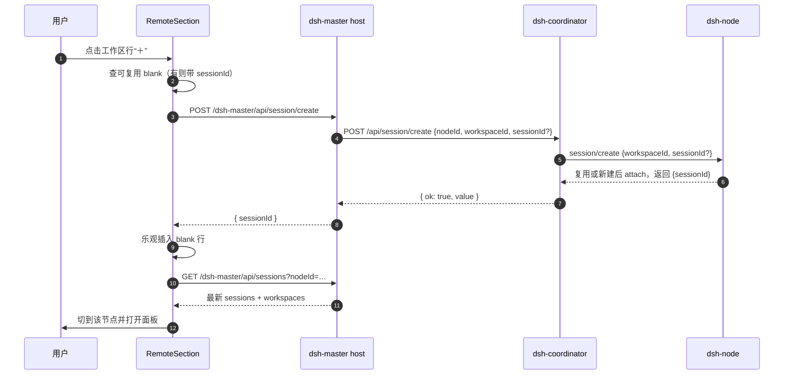

# 远程工作区目录“＋”新建会话实施方案

> 状态：**已实施**；构建、类型检查与 311 项自动化测试通过（1 项跳过），真实协调器/节点待复验。
> 日期：2026-11-03。
> 适用仓库：`G:\claude_project\code-agent\dsh-master`（另涉及只读依赖 `dsh-coordinator` / `dsh-node` 的既有能力，不修改这两个仓库）。

**Goal:** 在左侧远程工作树的每个已登记工作区目录行上提供与本地一致的“＋”，点击后在该远程节点、该工作区中创建（或复用）一个空白会话，切换到该节点并在远程主面板打开。

**Architecture:** 复用 coordinator 已提供的 `POST /api/session/create`（`nodeId` + `workspaceId`），在 `dsh-master` 内补齐 host 路由、coordinator 客户端、浏览器 API 封装和远程树行内按钮；不新增节点协议，不改 coordinator / node。

**Tech Stack:** 现有 React 18、TypeScript、Cordis、Vitest、`tools/build-styles.mjs`；不新增依赖。

---

## 1. 用户已确认的决策

| 决策点 | 选择 | 含义 |
| --- | --- | --- |
| 点击“＋” | **立即创建并打开空白会话** | 不弹对话框；与本地 `ProjectRowItem` 的“＋”一致。若已有可复用空白会话，把它的 id 随创建请求带上，由节点复用后返回同一个 id。 |
| 权限门控 | **不新增门控，像归档一样允许** | 创建空白会话不执行 Agent 回合；仍受信任围栏保护，`workspaceId` 必须由目标节点校验。`allowPrompt` 继续只控制发消息/上传。 |
| 空白会话可见性 | **仅当前选中时显示** | 建完立即以“新会话”行显示；切走或刷新后隐藏。首条消息后按正常标题显示（标题更新依赖手动刷新，见 §13）。 |

---

## 2. 能力核对结果（施工前必读）

| 事实 | 出处 / 结论 |
| --- | --- |
| coordinator 有 `POST /api/session/create`，接收 `nodeId` + `cwd` / `workspaceId` / `sessionId` / `agentPreset`，返回节点原值 | `dsh-coordinator/src/http-api.ts`、`src/sessions.ts`、`docs/GROUND-TRUTH.md`。**运行中的协调器本次未启动，未做实机核对**；实施前先确认部署版本含该路由。 |
| node 的 `session/create` 用 `workspaceId` 校验真实工作区，并 `attachSession` 后返回 `{ sessionId, agentPreset? }` | 会话控制器源码：`workspaceRegistry.get(workspaceId)`、`workspace.attachSession(sessionId)`。 |
| 不传 `sessionId` 时**一定会新建**，不会自动复用空白会话 | `SessionCommandController.create()` 走 `createMinted`；只有传入 `sessionId` 才走 `claim` → `reusable` 复用。**因此“＋”必须先查已有空白行并把 id 传下去**，否则连点会产生多个空会话。 |
| `workspaceId` 与 `cwd` 互斥 | node 对两者同时出现直接报 `gateway/bad-request`；本方案只允许 `workspaceId`。 |
| `dsh-master` 目前没有 create 路由/客户端方法 | `src/http-api.ts`、`src/coordinator/client.ts`、`src/client/api.ts` 均无。 |
| 远程树当前过滤所有 `blank` 会话 | `src/workspace/remote-model.ts` 的 `visibleRemoteSessions()`；不处理会导致“建完立即消失”。 |
| 远程工作区行当前是 `<button>` | `RemoteSection.tsx` 的 `workspaceRow`；HTML 不允许按钮内嵌按钮，必须改行结构。 |
| 本地“＋”的实现可参照 | `src/workspace/rows/Rows.tsx` 的 `ProjectRowItem`：`rowActions` + `iconButton` + `IconPlusOutlineRegular`，CSS 控制悬停显现。 |
| `onOpenRemoteSession` 已从 fork 暴露给 `RemoteSection` | `WorkspaceBrowser.tsx` 的 `remoteSectionProps`：先 `setBrowseScope({kind:'remote', nodeId})`，再打开面板。无需改 fork。 |

---

## 3. 目标与非目标

### 3.1 本次做

- 每个**已登记远程工作区目录行**右侧增加“＋”，位置、尺寸、悬停行为与本地一致。
- 点击后：
  1. 先在该 node + workspace 下查找可复用空白会话，把 id 作为 `sessionId` 随创建请求带上；没有则不带；
  2. 调用 host 新建，节点会复用传入的空白会话（可复用）或铸造新会话，并完成 workspace attach；
  3. 成功后立即乐观插入“新会话”行、强制刷新该节点，并打开远程面板；
  4. 创建期间该行按钮禁用；失败就地显示原因，不产生本地会话、不自动发 prompt。
- 空白会话仅在“当前选中”时显示，且不占用每目录 5 条的 overflow 名额。

### 3.2 本次不做

- 不把顶部“新会话”按钮改成“远程新会话”；入口只加在远程工作区目录行。
- 不新增“新建远程会话”对话框、标题输入、agentPreset 选择。
- 不给节点行、“未分组”桶、搜索态或折叠 rail 加“＋”。
- 不实现远程会话生命周期订阅；发首条消息后侧栏标题不会自动更新（现有缺口）。
- 不修改 coordinator / dsh-node；不新增 `cwd` 创建入口（防止浏览器指定任意目录）。
- 不改变本地工作区的“＋”和 `startSession` 逻辑。

---

## 4. 交互与视觉

### 4.1 行结构

把远程工作区头行从 `<button>` 改为与本地一致的 `div`：

```tsx
<div
  className={clsx(RowsCss.projectRow, css.workspaceRow)}
  role="treeitem"
  aria-expanded={directoryExpanded}
  title={workspace.path}
  onClick={() => onWorkspaceExpandedChange(key, !directoryExpanded)}
>
  <span className={clsx(RowsCss.slot, RowsCss.folder)}>…</span>
  <span className={clsx(RowsCss.slot, RowsCss.chevron)}>…</span>
  <span className={css.nodeTitle}>{title}</span>
  <span className={RowsCss.rowActions} data-dsh-workspace-actions>
    <button
      type="button"
      className={RowsCss.iconButton}
      aria-label={t('actions.newSession.aria', { name: title })}
      disabled={creating || unavailable || node.state !== 'ready' || createUnsupported}
      onClick={(event) => { event.stopPropagation(); void onCreate() }}
      title={creating ? t('remote.creatingSession') : undefined}
    >
      <IconPlusOutline16 />
    </button>
  </span>
</div>
```

- 外层 `groupSection` 不再承担 `role="treeitem"` / `aria-expanded`，由头行承担；与本地结构一致。
- 内嵌按钮阻止冒泡，避免点击“＋”同时折叠目录。
- 头行使用 `tabIndex={0}` 且支持 Enter / Space 折叠；获得焦点时显示“＋”，再按 Tab 即可到达按钮。空态/未分组行不渲染按钮。

### 4.2 显示规则

| 状态 | “＋”行为 |
| --- | --- |
| 默认 | 隐藏；行 hover 时显示（复用 `RowsCss.rowActions` 的 `:hover` 规则）。 |
| 键盘聚焦到按钮 | 显示；新增 `:focus-within` 规则。 |
| 触摸/无 hover 设备 | 常显；新增 `@media (hover: none)` 规则。 |
| 节点 offline / revoked | 行本身不渲染，无需处理。 |
| 节点非 `ready`（connecting / closing / unknown） | 禁用，避免在未就绪时写入。 |
| 快照不可用（`unavailable`，协调器已断） | 禁用，`title` 说明连接不可用。 |
| 正在创建（同 node+workspace） | 禁用，`title` = “正在新建会话…”，防重复点击。 |
| 节点不支持 create（首次失败且错误码为能力类） | 该节点内按钮禁用，行下显示“此节点不支持远程新建会话”；刷新后重试。 |

### 4.3 新建后的表现

1. 目标工作区若处于折叠，先置为展开。
2. 立即插入一行“新会话”（`t('session.new')`），不显示时间与 `…` 菜单（与本地 blank 行一致）。
3. 切换浏览范围到该节点并打开远程主面板；输入框行为沿用 `RemotePanel` 现有逻辑。
4. 后台强制刷新该节点；刷新结果替换乐观行，且该 blank 行只有仍被选中时才保留。

---

## 5. 数据流与接口契约



### 5.1 `src/protocol.ts`

```ts
/** POST /dsh-master/api/session/create */
export interface MasterCreateSessionRequest {
  readonly nodeId: string
  readonly workspaceId: string
  /** 复用的空白会话 id；不传则新建。 */
  readonly sessionId?: string
}

export interface MasterCreateSessionValue {
  readonly sessionId: string
  readonly agentPreset?: string
}
```

### 5.2 `src/coordinator/client.ts`

新增：

```ts
async createSession(
  nodeId: string,
  workspaceId: string,
  sessionId?: string,
  signal?: AbortSignal,
): Promise<MasterCreateSessionValue>
```

- `POST ${baseUrl}/api/session/create`，body `{ nodeId, workspaceId, ...(sessionId ? { sessionId } : {}) }`。
- 复用现有 `#call`（token、超时、失败 envelope 处理）。
- 严格解析返回值：`sessionId` 必须是非空字符串，否则抛 `master/coordinator-unreadable`；`agentPreset` 可选。
- 不把响应整体透传给浏览器，避免把未来字段（可能含凭据类信息）带出去。

### 5.3 `src/service.ts`

```ts
createSession(nodeId: string, workspaceId: string, sessionId?: string, signal?: AbortSignal):
  Promise<MasterCreateSessionValue>
```

- 只做参数边界检查（非空、长度上限），然后委托 `CoordinatorClient`。
- 不检查 `promptEnabled`：按用户决策，创建空白会话不属于“运行 Agent 回合”。

### 5.4 `src/http-api.ts`

新增路由 `POST /api/session/create`：

- 非 POST → 405 `master/method-not-allowed`。
- `readJsonBody`，超限 413（沿用 256 KiB）。
- 必填：`nodeId`、`workspaceId`；可选：`sessionId`。
- **不接受 `cwd` / `agentPreset`**；出现也忽略，不转发。
- 成功：`{ ok: true, value: { sessionId, agentPreset? } }`。
- 失败沿用 `classify()`：节点/协调器错误码原样透出。

### 5.5 `src/client/api.ts`

```ts
export async function createRemoteSession(
  nodeId: string,
  workspaceId: string,
  sessionId?: string,
  signal?: AbortSignal,
): Promise<MasterCreateSessionValue>
```

- 与 `archiveRemoteSession` 同构，`unwrap(await envelopeOf(response))`。

---

## 6. 前端实现

### 6.1 `src/workspace/remote-model.ts`

修改两个纯函数，保持可单测：

```ts
export function visibleRemoteSessions(
  sessions: readonly MasterSession[],
  expanded: boolean,
  archivedSessionIds: readonly string[] = [],
  currentSessionId?: string,
): { sessions: MasterSession[]; hiddenCount: number }
```

规则：

1. 过滤 archived。
2. `blank` 会话默认隐藏，但 `session.sessionId === currentSessionId` 时保留。
3. 5 条上限只统计非 blank 行；当前 blank 行始终保留，不占名额。
4. `expanded=false` 时保留当前 blank + 前 5 条普通会话；`hiddenCount` 只算被截掉的普通会话。

```ts
export function groupRemoteWorkspaces(
  workspaces: readonly MasterWorkspace[],
  sessions: readonly MasterSession[],
  archivedSessionIds: readonly string[] = [],
  currentSessionId?: string,
): …
```

- 把 `currentSessionId` 透传给 `visibleRemoteSessions`。
- 未分组桶同样保留当前 blank（通常不会出现，因为新建必定绑定 workspace）。

### 6.2 `src/workspace/RemoteSection.tsx`

新增状态：

| 状态 | 类型 | 用途 |
| --- | --- | --- |
| `creating` | `Record<string, boolean>` | key = `JSON.stringify([nodeId, workspaceId])` |
| `createErrors` | `Record<string, string>` | 行下错误文案，成功后清除 |
| `createUnsupported` | `Record<string, boolean>` | 节点能力不足，刷新时清空 |
| `createdBlanks` | `useRef<Map<string, string>>` | 刚创建、列表尚未刷新的 blank id，防连点重复创建 |

新增回调（`RemoteSection` 内定义，传给每个 `RemoteNodeSection`）：

```ts
const createSession = async (
  node: MasterNode,
  nodeName: string,
  unavailable: boolean,
  workspace: MasterWorkspace,
  data: MasterSessionsValue | undefined,
): Promise<void> => {
  const nodeId = node.nodeId
  const key = JSON.stringify([nodeId, workspace.workspaceId])
  if (creating[key] === true || unavailable || node.state !== 'ready' || nodeIsOffline(node)) return
  if (workspace.workspaceId === '') return

  // 只作为提示：节点会校验可复用性；不可复用则返回新的 sessionId。
  const reusable = findReusableBlank(data, workspace) ?? createdBlanks.current.get(key)

  setCreating(prev => ({ ...prev, [key]: true }))
  setCreateErrors(prev => omit(prev, key))
  try {
    const created = await createRemoteSession(nodeId, workspace.workspaceId, reusable)
    createdBlanks.current.set(key, created.sessionId)
    setData(prev => insertOptimisticBlank(prev, nodeId, workspace, created.sessionId))
    onWorkspaceExpandedChange(key, true)
    onOpenRemoteSession(nodeId, created.sessionId, nodeName, t('session.new'))
    void loadSessions(nodeId, true)
  } catch (cause) {
    setCreateErrors(prev => ({ ...prev, [key]: describe(cause) }))
    if (isCapabilityFailure(cause)) setCreateUnsupported(prev => ({ ...prev, [nodeId]: true }))
  } finally {
    setCreating(prev => omit(prev, key))
  }
}
```

辅助函数（放在 `remote-model.ts` 或 `RemoteSection.tsx` 内，便于测试）：

```ts
function findReusableBlank(
  data: MasterSessionsValue | undefined,
  workspace: MasterWorkspace,
): string | undefined {
  if (data === undefined) return undefined
  const archived = new Set(data.archivedSessionIds)
  return data.sessions.find(session => session.blank
    && !archived.has(session.sessionId)
    && workspace.sessionIds.includes(session.sessionId)
    && (session.cwd === undefined || session.cwd === workspace.path))?.sessionId
}
```

`insertOptimisticBlank`：

- 若 `data.sessions` 已有该 id，不动；
- 否则插入 `{ sessionId, title: '', updatedAt: Date.now(), running: false, blank: true, cwd: workspace.path }`；
- 同步把 id 加进对应 workspace 的 `sessionIds`（若尚未包含）。

`loadSessions` 成功回调里做一次清理：

```ts
for (const [key, id] of createdBlanks.current) {
  if (result.sessions.some(session => session.sessionId === id)) createdBlanks.current.delete(key)
}
```

这样列表一旦包含该 blank，后续复用完全走 `findReusableBlank`，不会错误复用一个已经发过消息的会话。

`RemoteNodeSection` 新增 props：

```ts
creatingKey?: boolean                  // 该目录是否正在创建
createError?: string                   // 该目录的错误
createUnsupported?: boolean            // 节点不支持
onCreateRemoteSession: (workspace: MasterWorkspace) => void
```

传给 `groupRemoteWorkspaces` 的当前会话 id：

```ts
groupRemoteWorkspaces(
  data?.workspaces ?? [],
  data?.sessions ?? [],
  data?.archivedSessionIds ?? [],
  selection?.nodeId === node.nodeId ? selection.sessionId : undefined,
)
```

### 6.3 空白会话行

`RemoteSessionItem`：

- 展示标题：`session.blank ? t('session.new') : session.title`。
- `blank` 时：不显示 `sessionAge`，不显示归档 `…` 菜单（与本地 blank 行一致）。
- `title` 属性继续用 `sessionId`，便于排查。
- 选中判定不变（nodeId + sessionId）。

### 6.4 CSS：`src/workspace/RemoteSection.module.css`

```css
.workspaceRow { cursor: pointer; }

.workspaceRow:focus-visible {
  outline: 2px solid #91a9df;
  outline-offset: -2px;
}

.workspaceRow:focus-within [data-dsh-workspace-actions] {
  display: inline-flex;
}

@media (hover: none) {
  .workspaceRow [data-dsh-workspace-actions] { display: inline-flex; }
}
```

- `RowsCss.rowActions` 已提供 hover 显现、gap 12、16px 图标。
- 生成的样式必须重跑 `node tools/build-styles.mjs`，否则 `styles.generated.ts` 不含新规则。

### 6.5 `src/workspace/locales.ts`

新增（zh / en 同步）：

| key | zh | en |
| --- | --- | --- |
| `remote.creatingSession` | 正在新建会话… | Creating a session… |
| `remote.createSessionFailed` | 新建会话失败 | Couldn’t create the session |
| `remote.createSessionUnsupported` | 此节点不支持远程新建会话 | This node can’t create remote sessions |
| `remote.createSessionUnavailable` | 节点未就绪，暂时无法新建会话 | The node isn’t ready to create a session |

复用已有 `actions.newSession.aria`（“在“{name}”中新建会话”）。

---

## 7. 文件改动清单

| 文件 | 改动 |
| --- | --- |
| `src/protocol.ts` | 新增 create 请求/响应类型 |
| `src/coordinator/client.ts` | `createSession()` + 响应校验 |
| `src/service.ts` | 委托方法 |
| `src/http-api.ts` | `POST /api/session/create` 路由与参数校验 |
| `src/client/api.ts` | `createRemoteSession()` |
| `src/workspace/remote-model.ts` | blank 当前会话例外 + overflow 计数规则 |
| `src/workspace/RemoteSection.tsx` | 行结构、＋按钮、创建状态/错误/乐观插入 |
| `src/workspace/RemoteSection.module.css` | 焦点/触摸显现规则 |
| `src/workspace/locales.ts` | 新增 3 组文案 |
| `src/workspace/styles.generated.ts` | 由生成器重写，不手改 |
| `test/coordinator-client.test.ts` | 请求体、响应解析、错误 |
| `test/http-api.test.ts` | 路由校验、无 prompt 副作用 |
| `test/client-api.test.ts` | 封装 URL/body |
| `test/remote-model.test.ts` | blank 例外、5 条上限 |
| `test/remote-section.test.ts` | ＋渲染/点击/禁用/错误 |
| `docs/GROUND-TRUTH.md` | 新路由与 node create 契约 |
| `docs/design.md` | 能力表、安全模型补一行 |
| `docs/log.md` | 变更记录 |
| `README.md` | 如已有远程功能列表，补一句入口说明 |

不改 `src/workspace/rows/*`（fork）、`src/workspace/contract/slots.ts`、coordinator / node 仓库。

---

## 8. 失败与边界

| 场景 | 期望行为 |
| --- | --- |
| 已有可复用 blank | 把 id 作为 `sessionId` 传入；节点复用并返回同一 id，不新增第二个空会话。 |
| 连点“＋” | 同一 key 在请求期间禁用；请求返回后列表刷新前由 `createdBlanks` 兜底，不产生第二个空会话。 |
| 节点离线 / 已撤销 | 目录行不渲染，无“＋”。 |
| 协调器断开但保留旧快照 | “＋”禁用；不基于陈旧数据创建。 |
| 部署的 coordinator 没有 `/api/session/create` | 返回 `coordinator/invalid-arguments`（message 含 `no route`）；提示升级协调器，不把节点标记为不支持。 |
| 节点不支持 `session/create` | 错误码为 `node/capability-unavailable` 或 `coordinator/capability-mismatch` 时，标记该节点不支持并禁用“＋”；行下显示具体错误。刷新后重试；不回退本地创建。 |
| `workspace/not-found`（目录被删） | 行下显示错误；建议用户刷新；不自动跳到别的目录。 |
| 创建成功但 `attachSession` 失败 | 显示 `session/workspace-attach-failed`；不打开伪造会话；提示可能已产生未分组空会话，刷新确认。 |
| 请求超时（可能已在远端创建） | 显示“可能已创建，请刷新确认”；**不自动重试**，避免重复。 |
| 刷新失败 | 保留乐观“新会话”行与已打开面板；节点级错误照常显示；下次刷新以服务端为准。 |
| 选中后切走 | 该 blank 行在下一次渲染即隐藏（`selection` 参与过滤），不需要额外请求。 |
| 首条消息发送后 | 会话变为非 blank；侧栏标题/时间需手动刷新才更新（现有生命周期缺口）。 |
| 搜索态 | 远程区被隐藏，无“＋”；退出搜索后恢复。 |
| 折叠 rail | 只显示节点图标，无“＋”。 |

---

## 9. 实施顺序

1. **Host 契约**
   - `protocol.ts` → `coordinator/client.ts` → `service.ts` → `http-api.ts` → `client/api.ts`。
   - 补单元测试：请求体只含允许字段、响应缺 `sessionId` 报 `master/coordinator-unreadable`、路由拒绝 GET/空 `workspaceId`。
2. **远程模型**
   - 先改 `remote-model.ts` + `test/remote-model.test.ts`，把“当前 blank 可见且不占 5 条名额”固定下来。
3. **UI**
   - `RemoteSection.tsx` 行结构与“＋”；创建状态、乐观插入、复用 blank、错误显示。
   - `locales.ts` 文案；`RemoteSection.module.css` 焦点/触摸规则。
4. **生成与构建**
   - `node tools/build-styles.mjs`
   - `pnpm build`（先 declarations 再 tsdown）
   - `pnpm typecheck`
   - `pnpm test`（测试读 `lib/client.js`，必须先 build）
5. **文档**
   - 更新 `docs/GROUND-TRUTH.md`、`docs/design.md`、`docs/log.md`。
6. **真机验证**（见 §10.2）。

---

## 10. 验证计划

### 10.1 自动化

新增/更新断言：

- `remote-model`：当前 blank 在 collapsed/expanded 下都可见；普通会话仍限 5 条；非当前 blank 不可见；archived 优先隐藏。
- `remote-section`：每个 workspace 行渲染“＋”；点击调用 `onCreateRemoteSession` 并阻止折叠；`creating` 时禁用；`unavailable` 时禁用；错误显示在行下；blank 行显示“新会话”且无菜单。
- `http-api`：`POST /api/session/create` 成功转发 `{nodeId, workspaceId}`；拒绝非 POST、缺字段、超长 body；不调用 prompt。
- `coordinator-client`：body 含 `workspaceId`、不含 `cwd`；解析 `{sessionId}`；拒绝空/缺 `sessionId`。
- `client-api`：URL 为 `${ROUTE_PREFIX}/api/session/create`，body 正确。
- `workspace-styles`：生成的 CSS 含 `[data-dsh-workspace-actions]` 规则（生成器 `--check` 通过）。

命令：

```powershell
node tools/build-styles.mjs
node tools/import-fork.mjs --check
pnpm build
pnpm typecheck
pnpm test
```

### 10.2 真机

前置：协调器运行、至少一个 `ready` 节点、DSH 重启（host 半侧有改动，客户端 HMR 不够）。

| 检查 | 预期 |
| --- | --- |
| 远程目录行 hover | 出现“＋”，位置/大小与本地一致；不挤压标题。 |
| 点击“＋”（空目录） | 新会话创建成功，侧栏出现“新会话”，右侧面板打开。 |
| 再点同一目录“＋” | 带上已有 blank id，复用同一个会话，不新增第二个。 |
| 在空白会话发首条消息后刷新 | 会话变为正常标题；不再作为 blank 显示。 |
| 切到本地会话再刷新 | 未发送的 blank 行消失。 |
| 节点离线 / 协调器停止 | “＋”禁用或行消失，不出现伪成功。 |
| 旧节点（不支持 create） | 显示具体错误，不回退本地创建。 |
| 目录已在远端删除 | 明确报错，不误建到别的目录。 |
| 浏览器 Network | 只请求 `/dsh-master/api/session/create`，不直连 coordinator。 |

验收前把结果写入 `docs/GROUND-TRUTH.md`，不要把“合成测试通过”写成“真机已验证”。

---

## 11. 验收标准

- [ ] 每个远程工作区目录行有“＋”，悬停/键盘聚焦/触摸可见，行为与本地一致。
- [ ] 点击后绑定正确的 node + workspace，不触发本地会话创建，不自动发 prompt。
- [ ] 已有空白会话被复用；连点/超时重试不产生多个空会话。
- [ ] 新 blank 行立即可见且可输入；切走后按规则隐藏。
- [ ] 空白行不占 5 条 overflow 名额；普通会话 overflow 行为不回归。
- [ ] 失败场景有具体错误，不显示伪成功，不跨节点/目录串用 id。
- [ ] `pnpm build`、`pnpm typecheck`、`pnpm test`、`node tools/build-styles.mjs --check` 全部通过。
- [ ] 真机验证完成并记录。

---

## 12. 风险与回滚

| 风险 | 缓解 |
| --- | --- |
| 部署的 coordinator 版本没有 `/api/session/create` | 实施前先核对；缺失时先升级 coordinator，不在 master 里伪造。 |
| 旧节点不广告 `session/create` | 首次调用失败即提示，禁用该节点入口，不反复重试。 |
| 空白会话 id 校验/归档竞态 | `findReusableBlank` 同时检查 blank、未归档、workspace 成员、cwd 一致。 |
| 创建超时导致远端孤儿会话 | 不自动重试；提示刷新确认；保持幂等键不可用时的保守策略。 |
| 远程标题不自动更新 | 已知限制，手动刷新；后续接生命周期事件。 |
| 样式生成遗漏 | `build-styles --check` + `workspace-styles` 测试守护。 |

回滚：删除新增路由与 UI 入口即可；不涉及配置 schema、持久化或 coordinator/node 改动，回滚无数据迁移。

---

## 13. 已知限制

- 会话生命周期事件未透传：新建后若在别处发送首条消息，本侧栏标题/时间需手动刷新。
- 节点级能力无法在 roster 中精确得知；只在实际调用失败后降级。
- 不提供“命名新会话”“选择 agentPreset”“恢复已归档会话”；这些属于后续独立任务。
