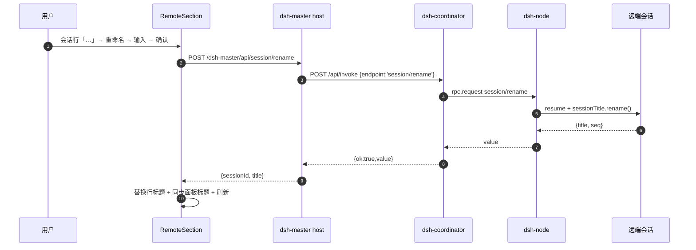

# 远程会话重命名实施方案

> 状态：**已实施**（自动化验证通过，真机待复验）。日期：2026-11-11。适用仓库：`dsh-master`（只改本仓；不修改 `dsh-coordinator`、`dsh-node` 与 fork 目录 `src/workspace/rows/*`）。

**Goal:** 在左侧远程树的会话行「…」菜单里提供“重命名”，把用户在弹窗里输入的标题写到远端会话（`session/rename`），并让侧栏、关注列表和已打开的远程面板立即显示新标题。

**Architecture:** 复用远端 DSH 已注册的 `session/rename` Remote，经 `coordinator /api/invoke` 转发；`dsh-master` 内补齐 route、coordinator 客户端方法、service 边界校验、浏览器封装、行菜单与弹窗。不新增节点协议，不改 coordinator/node。

**Tech Stack:** 现有 React 18、TypeScript、Cordis、Vitest、`tools/build-styles.mjs`；不新增依赖。

---

## 1. 语义与协议事实

| 事实 | 含义 |
| --- | --- |
| `session/rename` 入参 `{request:{sessionId,title}}`，返回 `{title,seq}` | 节点先 `resolveAgent`（必要时 resume 该会话），再由 `sessionTitle` 服务写入 |
| 写入的是 `session/title` 事件（`source: {kind:'user'}`） | 会覆盖后续的自动标题生成；标题成为用户固定值 |
| 节点会规范化标题 | 去除控制字符、折叠空白、trim，并按 `maxTitleBytes` 截断；**返回值才是权威标题** |
| 规范化后为空 → `session/title-invalid` | 空白标题由 master 先拦，不依赖节点兜底 |
| 未挂载 session-title 服务 → `gateway/internal`（消息含 “renaming is unavailable”） | 按普通错误就地显示，不标记能力不足 |
| 重命名会 resume 会话 | 与在面板里打开它等价，不执行 Agent 回合、不改文件 |
| 已有 `rename` / `rename.session.title` / `field.sessionName` 文案 | 与本地会话重命名一致，直接复用 |

本地重命名有一条特殊交互：**标题未改变时仍允许确认**，因为“确认当前自动标题”正是把它固定成用户标题的手势。远程沿用该规则。

---

## 2. 交互

- 会话行「…」菜单新增第一项“重命名”（仅在非 blank 行提供菜单，与现状一致）。
- 节点非 `ready`、快照过期或节点不支持时，菜单项置灰。
- 弹窗：`Modal`，标题 `rename.session.title`，输入框预填当前标题并全选，`aria-label` 用 `field.sessionName`，上限 200 字符。
- Enter 提交（输入法组合期不提交）；Esc/取消关闭；提交中禁用两个按钮并显示“正在重命名会话…”。
- 成功后：
  1. 取消该节点在途的列表请求（否则早于重命名的响应会把旧标题写回）；
  2. 用节点返回的标题替换该行；
  3. 若该会话正是主面板打开的会话，同步更新 selection 的 `sessionTitle`，面板标题立即变化；
  4. 后台强制刷新该节点（`updatedAt` 与顺序以节点为准）。
- 失败：内联 `重命名会话失败 · code: message`；`node/capability-unavailable` / `coordinator/capability-mismatch` 时标记该节点，隐藏入口并显示节点级提示，直到下次刷新。

---

## 3. 接口



### 3.1 `src/protocol.ts`

```ts
export const MAX_SESSION_TITLE_LENGTH = 200
export interface MasterRenameSessionRequest { nodeId: string; sessionId: string; title: string }
export interface MasterRenameSessionValue { sessionId: string; title: string }
```

### 3.2 分层

| 层 | 方法/路由 | 规则 |
| --- | --- | --- |
| `coordinator/client.ts` | `renameSession(nodeId, sessionId, title)` | `#invokeNode('session/rename', {request:{sessionId,title}})`；返回值必须有非空 `title`，否则 `master/coordinator-unreadable` |
| `service.ts` | `renameSession()` | 校验非空 id、trim 后非空、长度 ≤ 200；**不检查 `promptEnabled`** |
| `http-api.ts` | `POST /api/session/rename` | 405/503/400/413 与既有路由一致；只读 `nodeId`/`sessionId`/`title`，其它字段忽略 |
| `client/api.ts` | `renameRemoteSession()` | 只发三个字段，`unwrap` 信封 |

---

## 4. 前端

| 文件 | 改动 |
| --- | --- |
| `src/workspace/RemoteSection.tsx` | `RemoteSessionItem` 增加 `onRenameSessionRequest` / `renameDisabled` 与菜单项；`RemoteNodeSection` 透传并在能力不足时显示提示；`RemoteSection` 增加弹窗、提交状态、防连点、竞态取消、面板标题同步 |
| `src/workspace/remote-model.ts` | `replaceSessionTitle()` 纯函数 |
| `src/workspace/RemoteSection.module.css` | 复用 `.renameInput` / `.renameError` |
| `src/workspace/locales.ts` | `remote.sessionRenaming` / `remote.sessionRenameFailed` / `remote.sessionRenameUnsupported` |

失败矩阵：

| 场景 | 表现 |
| --- | --- |
| 空白 / 超长标题 | 客户端与路由双重拦截，不发上游请求 |
| `session/title-invalid` | 内联错误，保留弹窗 |
| `session/not-found` | 内联错误；刷新后该行消失 |
| `gateway/internal`（未挂载标题服务） | 内联错误；不误标为能力不足 |
| 节点离线 / 协调器断开 | 内联错误；不乐观改标题 |
| 超时 | 不自动重试；提示刷新确认（可能已生效） |
| 节点缺少该 Remote | 隐藏入口 + 节点级提示，刷新后重试 |

---

## 5. 验证

- `node tools/build-styles.mjs --check`：通过（`.renameInput` / `.renameError` 已生成）。
- `pnpm build`、`pnpm typecheck`：通过。
- Vitest：**46 文件 / 438 测试全部通过**（`DSH_RUNTIME_ROOT` 指向已安装 runtime）。
  - `coordinator-client`：invoke 端点与参数、采用节点返回标题、缺标题报错、service trim 与边界。
  - `http-api`：POST-only、字段校验、超长/空白不调用 service、`promptEnabled=false` 仍可用。
  - `client-api`：URL 与 body。
  - `remote-model`：只替换目标行、不改成员/顺序/归档、不原地改缓存。
  - `remote-section`：菜单项顺序与回调、非 ready 置灰、未接线时不出现、节点级提示。

**待办**：真机验证需重启 DSH 让 host 侧新路由生效，检查项见下；验证后把结果追加到 `docs/GROUND-TRUTH.md`。

真机检查：重命名成功后侧栏与面板标题同步；刷新后仍是新标题；未改名时确认可固定自动标题；空白标题被拦截；旧节点（无 `session/rename`）显示不支持；远端 `session/title` 事件 `source.kind = user`。

---

## 6. 已知限制与回滚

- 重命名会 resume 该会话（与打开它等价）；不会发消息、不会跑 Agent 回合。
- 标题由节点规范化，客户端显示返回值，不保证与输入逐字相同。
- 其他客户端/操作者的侧栏不会自动更新（master 仍不做会话生命周期订阅）。
- 回滚：删除路由、菜单项、弹窗与 `replaceSessionTitle` 即可，无 schema/持久化变更。
