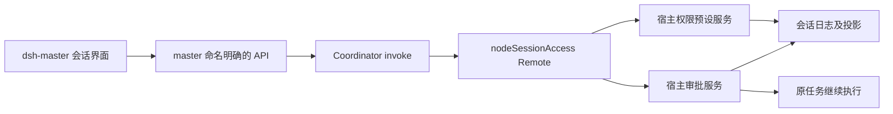
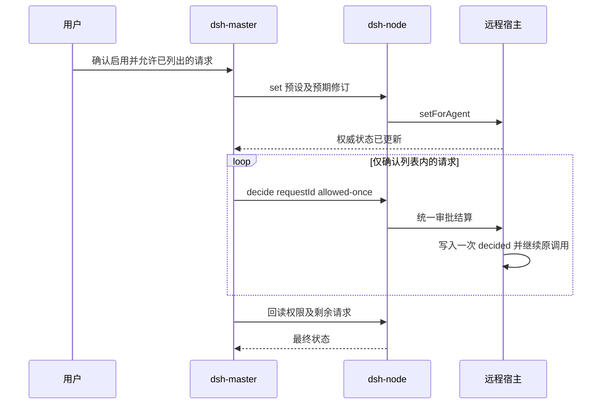

# 远程会话 Full Access 设计

日期：2026-11-06。状态：待用户评审；本次仅制定方案，不修改产品代码或发布。

## 目标与已确认范围

用户希望在 dsh-master 切换远程 DSH 会话的 Full Access，并能在 dsh-master 继续已经停在“等待授权”的当前任务。

本方案采用的默认选择：只修改当前 nodeId + sessionId 对应的会话；支持切回远程提供的其他预设；不修改其他会话、节点全局配置和新会话默认权限。沿用 TypeScript、Cordis、Typert Gateway、React 和 Vitest，不引入新依赖。

## 已核实的事实

| 位置 | 事实 | 对设计的影响 |
| --- | --- | --- |
| dsh-node/src/protocol.ts | 节点 `full-access` 仅表示没有额外 Remote 白名单 | 不能以节点模式推断会话权限 |
| deepseek-harness/packages/interaction/permission-presets/src/index.ts | 内置 `danger-full-access` = sandbox `danger-full-access` + approval `never`；已有 permissions 投影、set(session, name) 和 /permission 命令 | 复用预设和持久化机制 |
| deepseek-harness/packages/interaction/user-approval/src/index.ts | `never` 对仍需审批的请求返回 rejected；修改策略不会结算已等待的 waterfall | 必须单独处理当前待审批请求 |
| 同上 | request() 生成审计 id 并写入 asked/decided，但未提供待审批查询与外部结算接口 | 在审批所有者处补统一生命周期，不能由前端拼接日志冒充批准 |
| dsh-node/src/index.ts | Gateway Peer 使用 owner + interactions:none | 普通 RPC 转发不会自动带回互动授权 |
| dsh-node/src/user-questions.ts | 已有会话查看租约与结构化问题桥接 | 可借鉴租约，审批仍使用独立的数据与结算类型 |
| dsh-master/src/client/SessionView.tsx、wire.ts | 权限按钮 disabled，审批事件仅展示通知 | 需要真实权限控件与审批操作 |

这些事实来自相邻源码，不代表运行中的远程机器已安装同一版本；上线前必须检查实际宿主能力。

## 推荐架构

采用“远程宿主拥有权限与审批真相，node 提供命名明确的桥接，master 提供操作界面”。Coordinator 继续转发现有 /api/invoke，不承担审批状态。

不采用仅发送 `/permission ...` 普通消息的方案：命令可能被排在挂起任务后面，也不能可靠结算原审批。也不采用 master 私有状态或直接写会话日志：执行状态应由宿主服务负责。

### 1. 宿主能力：deepseek-harness

- 权限服务新增 `setForAgent(agent, preset)`，与本地 `/permission` 共用实时写入路径，保留现有 sandbox/mode、approval/policy、permission/preset 及对活跃 Agent 的通知语义。
- 审批服务增加 pending(session)、外部 decide(session, requestId, outcome) 及等待决策的内部机制，维护同一份活跃请求表。审计 id 就是外部请求 id。
- 本地 UI 回答、远程回答、取消和卸载竞争同一终态；每个请求只写一次 approval/decided。外部决策可结束已经交给本地回答者等待的请求，并撤回其 UI。
- 外部允许只接受 `allowed-once` 或 `rejected`；cancelled/unavailable 由生命周期产生。审批取消信号与工具本身的取消信号分开，远程批准撤回旧面板不能取消原工具。
- `never` 保持现有含义，不能改成对所有请求自动批准。Full Access 主要通过取消工具的沙箱限制工作；额外业务审批仍由其规则决定。
- 活跃审批只存在于当前进程内；重启不从历史 asked 事件重新构造可执行批准。

### 2. 节点桥接：dsh-node

新建 `src/session-access.ts`，注册 `nodeSessionAccess` Remote；通过宿主正式 Agent/session lookup 解析已有会话，不创建新会话、不绕过作用域检查。

| 方法 | 参数 | 返回 |
| --- | --- | --- |
| get | sessionId | preset/current options、活跃 pendingApprovals、revision、supportsResumePending |
| set | sessionId, preset, expectedRevision, operationId | 权威权限状态及新的 revision |
| decide | sessionId, requestId, outcome, operationId | 此请求的终态；重复相同决策返回同一结果 |

`get` 返回的 revision 覆盖预设及实际 sandbox/approval 值。options 来源于远程预设表，包含可核实的 sandbox、approval 语义；custom 仅展示。Full Access 标签仅用于确实具有 danger-full-access + never 的预设。

通过宿主审批事件安装会话范围的远程回答者：master 每 5 秒刷新当前会话 get，维持 15 秒查看租约；仅在有效租约内为远程等待提供回答者，没有租约时沿用本机处理。宿主审批服务的统一 pending 表使已由本地 UI 接管的请求也可远程查询和结算。

租约过期时，节点回答者退出并委托既有回答链；本机无回答者则 unavailable，不无限等待。网络重连且租约仍有效时保留 pending；节点插件卸载撤回其回答者，宿主/Agent 取消按标准生命周期结算。租约只控制由谁等待，不构成授权凭证。

set 必须先验证远程支持该预设，再比较 expectedRevision，最后通过宿主服务写入；旧修订返回 conflict。operationId 按会话缓存已完成结果，防止响应丢失后的重复提交；进程重启后先回读再决策，不自动重放允许操作。

### 3. master 操作与交互

- 新增 GET `/api/session/access`、POST `/api/session/access/set`、POST `/api/session/access/decide`，沿用现有鉴权、同源与输入校验边界；浏览器不能提交任意 endpoint。
- get 可只读访问；set 和 decide 在后端检查现有 `allowPrompt`，关闭时不能通过直接请求修改权限或批准操作。
- 当前会话权限按钮展示远程真实预设和加载/失败状态，支持切换和切回；切换期间禁止重复提交，后端成功并回读后才展示已生效。
- 选择 Full Access 时沿用本地权限控件的确认交互，明确节点名和会话名；有待审批请求时，确认文字为“启用完全权限，并允许当前列出的 N 项操作继续”。只批准该确认中列出的 requestId。
- 主路径先完成 set，确认实际权限已更新，再逐项 decide(allowed-once)。set 失败不批准任何请求。新增请求不被本次确认自动批准；已取消或已结算的请求刷新状态，不重放工具。
- 若部分批准失败，保留已生效的 Full Access，展示“权限已切换，仍有 N 项待处理”，提供逐项允许/拒绝及刷新入口；不得报告整体成功，也不回滚并伪装已经执行的操作未发生。
- 等待授权时提供“允许一次”“拒绝”和“启用完全权限并继续”，不通过发送新 prompt 假装恢复原调用。
- 本机或另一 master 更改权限后，通过已有会话投影刷新及定期回读同步。切换节点/会话时取消旧请求，丢弃旧响应。

## 当前任务恢复的精确定义

恢复的是仍处于等待中的原工具调用，不重复执行已经成功、失败或取消的调用。已收到 rejected/unavailable 并结束的调用不是 pending，界面应明确需要用户继续任务，不自动重试具有副作用的操作。运行中已启动的命令也不因权限切换重启；后续权限检查读取新值。

## 兼容与交付

- 以节点实际 advertised capabilities 和宿主接口能力探测为准，不猜测最低版本号。
- 旧节点显示“不支持远程权限切换”；宿主缺统一审批能力时，不开放“切换并继续”并说明升级宿主，不能声称 node 单独升级即可完成。
- 上线顺序：远程宿主能力 → node → master；Coordinator 只有在集成测试发现其既有接口拒绝新 namespace 时才做必要兼容修改。
- 新代码不能追溯接管升级前进程中未注册的新机制的 Promise；首次升级可能需要结束旧任务后重试。功能上线后新产生的 pending 必须满足无重试继续的验收。
- 本次不涉及默认全局 Full Access、不修改 Codex 当前聊天权限、不做任意系统调用入口，也不扩展计划审核和普通问题的处理范围。

## 验收标准

1. 在 master 切到 Full Access 后，远程实际 sandbox/approval 值正确，工作区外的受控文件操作成功；不是只改变标签。
2. 同一部署中已经等待授权的原任务，可在 master 确认切换并允许后继续，工具调用只执行一次。
3. 切回 workspace-write 后，新操作重新受该预设限制；已有运行中的进程不承诺被追溯收回能力。
4. 会话隔离、刷新恢复、宿主重启后的权限持久化、另一客户端同步均正确。
5. 本机/远程抢答、重复点击、超时、断线、取消、过期修订、旧节点均不会造成重复执行、跨会话批准或虚假成功。
6. Full Access 不会自动回答计划审核、业务提问或未来额外业务审批。
